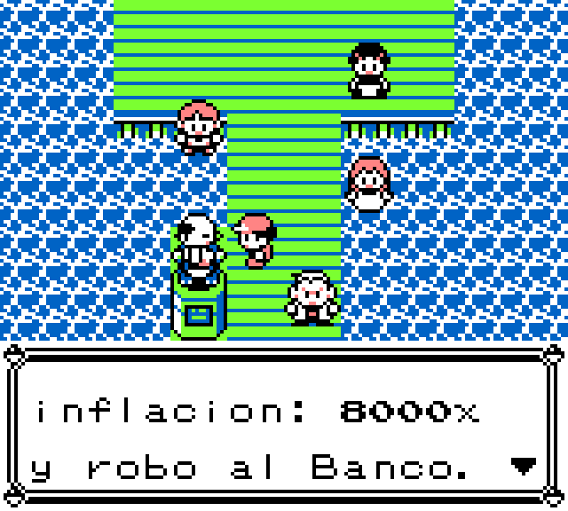
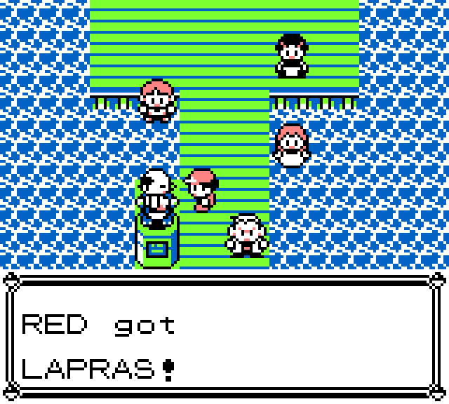
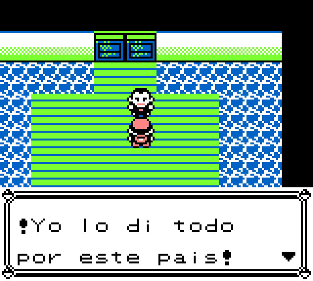
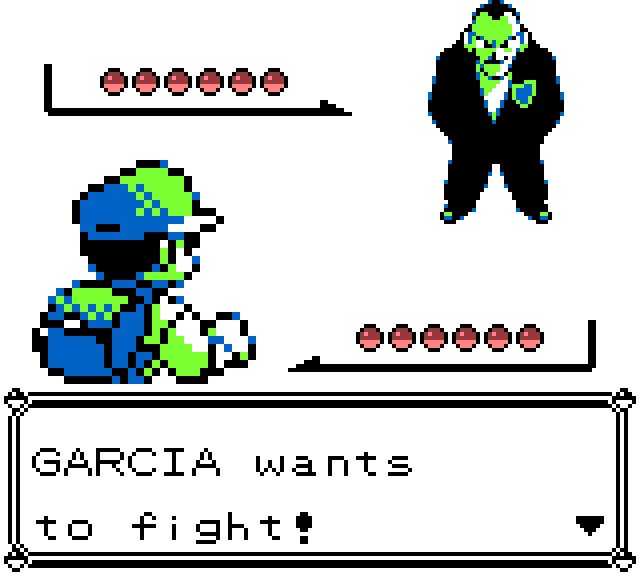
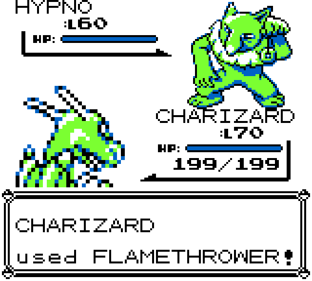
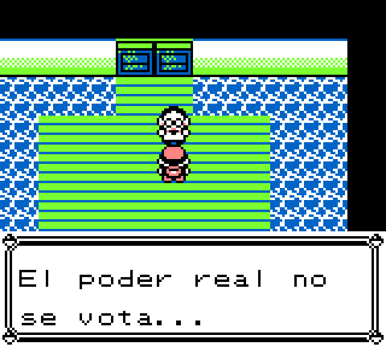
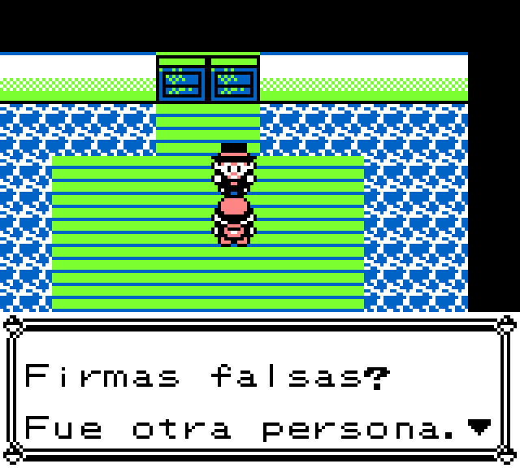
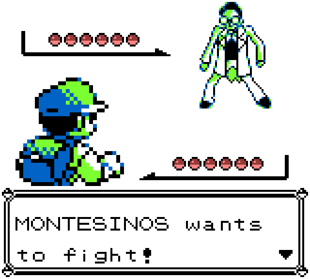
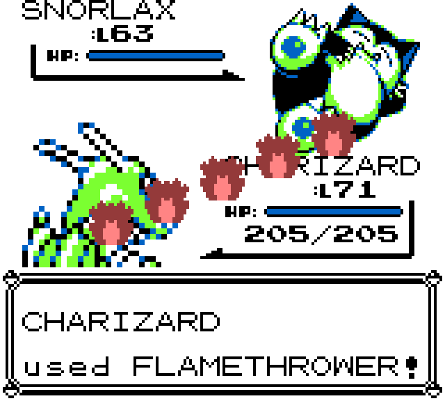

# El Pacto Corrupto del Perú 🎮

> ⚠️ **Aviso.** Proyecto de fan y de sátira política **sin fines de lucro**, no
> afiliado a Nintendo ni a Game Freak. Para el parche completo se requiere una
> copia legítima de Pokémon Rojo.
>
> ⚠️ **Disclaimer.** **Non-profit** fan project and political satire, not
> affiliated with Nintendo or Game Freak. A legitimate copy of Pokémon Red is
> required for the full patch.

[Español](#español) · [English](#english)

### 🕹️ Juega online, gratis · Play online, free → **https://r0n4ldernest0.github.io/el-pacto-corrupto/**
Directo en el navegador, en PC o celular, sin instalar nada · Right in the browser, on PC or phone, nothing to install.

> **Resumen.** Un fan game de sátira política: un *ROM hack* de Pokémon Rojo en
> el que, en lugar de la Liga Pokémon, enfrentas a cinco de los políticos más
> cuestionados de la historia del Perú. Quienes completan la liga reciben un
> **mensaje especial sobre la importancia de votar con conciencia**.
>
> **Summary.** A political-satire fan game: a Pokémon Red *ROM hack* where,
> instead of the Pokémon League, you battle five of the most controversial
> politicians in Peru's history. Players who beat the league get a **special
> message about the importance of voting wisely**.

<p align="center">
  
  
  
</p>
<p align="center">
  
  
</p>

---

## Español

### ¿Por qué este juego?
El Perú ha vivido una de las crisis de corrupción más profundas de América
Latina. Presidentes elegidos han terminado en prisión, como prófugos o bajo
investigación por sobornos y crímenes de Estado.

Alan García. Vladimiro Montesinos. Alejandro Toledo. Alberto Fujimori. Keiko
Fujimori. Nombres que marcaron generaciones y traicionaron la confianza de
millones de peruanos que creyeron en un país mejor.

Este juego nació en el contexto de las elecciones del 2026, un momento en que la
corrupción no es historia pasada: sigue viva y busca volver al poder. Nació
también de algo personal. Siempre me gustaron los videojuegos porque cuentan
historias y porque inspiran, y siempre quise hacer uno.

> *Esto es solo un juego. Pero espero que el espíritu trascienda: que podamos
> pelear en las urnas como peleamos aquí, y que algún día triunfemos sobre la
> corrupción.*

### ¿De qué trata?
Al empezar una partida nueva pasas por la intro normal del juego (Profesor Oak,
nombre del personaje, tu cuarto). Al salir de casa, en vez de Pueblo Paleta,
entras directamente a **El Pacto Corrupto**.

**1. El pasillo.** Cada NPC te cuenta el crimen de uno de los rivales y te
entrega un Pokémon para enfrentarlo. Así armas tu equipo de seis: Charizard,
Lapras, Alakazam, Machamp, Gengar y Snorlax, además de pociones, curas,
revivires y restauradores de PP.

| Testimonio | Recibes un Pokémon |
|---|---|
|  |  |

**2. La liga.** Enfrentas uno por uno, al estilo del Alto Mando, a:

| Rival | Tema |
|---|---|
| Alan García | Corrupción e hiperinflación |
| Vladimiro Montesinos | Espionaje, compra de jueces y generales |
| Alejandro Toledo | Sobornos de Odebrecht y lavado de activos |
| Alberto Fujimori | Autoritarismo y crímenes de Estado |
| Keiko Fujimori | **Jefa final**: financiamiento ilegal (con la música del Campeón) |

Cada rival tiene su propio diálogo antes y después de la pelea.

| Hablando con el primer rival | La batalla |
|---|---|
|  |  |

Los demás rivales también tienen su propio diálogo y su propio equipo:

| Montesinos | Toledo |
|---|---|
|  |  |
|  |  |

**3. El final.** 🗳️ Al derrotar a los cinco te espera un **mensaje especial
sobre la importancia de votar con conciencia**, porque la batalla real no se
juega aquí. No te lo spoileamos: tendrás que ganarte la liga para leerlo.

**Controles:** flechas para moverte, `Z` = A, `X` = B, `Enter` = Start. En el
celular aparece un gamepad táctil.

### ¿Cómo funciona técnicamente?
Este repositorio es el **sitio web** del juego, servido con GitHub Pages. El ROM
se compiló aparte a partir del desensamblaje de código abierto
[pret/pokered](https://github.com/pret/pokered) con [RGBDS](https://rgbds.gbdev.io/):
mapas, diálogos, entrenadores, equipos y la secuencia final modificados.

- **Página estática** (`index.html` + `style.css`), sin framework ni build.
- **Bilingüe ES/EN**: cada texto tiene sus atributos `data-es` y `data-en`, y el
  botón del menú los intercambia con un pequeño script.
- **Emulador en el navegador**: [EmulatorJS](https://emulatorjs.org/) con el core
  **mGBA** compilado a WebAssembly, alojado localmente en `lib/` (así no depende
  de un CDN). Se configura con:
  ```js
  EJS_player = '#game'; EJS_core = 'mgba';
  EJS_gameUrl = 'pokered_corrupt.gbc'; EJS_pathtodata = './lib/data/';
  EJS_language = 'es'; EJS_startOnLoaded = true;
  ```
- **Parche `.bps`**: la sección de descarga explica cómo aplicar el parche a una
  copia propia de Pokémon Red (USA/Europe) con
  [Floating IPS](https://github.com/Alcaro/Flips).
- **Capturas**: tomadas del ROM corriendo en local con el emulador
  [PyBoy](https://github.com/Baekalfen/PyBoy), en `screenshots/`.

### Estructura
```
index.html            Página: por qué, sobre el juego, capturas, emulador, descarga, autor
style.css             Estilos (tema oscuro rojo/dorado)
pokered_corrupt.gbc   ROM de la demo que carga el emulador
screenshots/          Capturas del juego
lib/
  cores/              Cores mGBA en WebAssembly
  data/               Loader de EmulatorJS, gamepad táctil, shaders, traducciones
```

### Ejecutar localmente
El emulador necesita servirse por HTTP (no funciona abriendo el archivo con
`file://`):
```bash
python -m http.server 8000
# abre http://localhost:8000
```

---

## English

### Why this game?
Peru has gone through one of the deepest corruption crises in Latin America.
Elected presidents have ended up in prison, as fugitives, or under investigation
for bribery and crimes of State.

Alan García. Vladimiro Montesinos. Alejandro Toledo. Alberto Fujimori. Keiko
Fujimori. Names that defined generations and betrayed the trust of millions of
Peruvians who believed in a better country.

This game was born in the context of the 2026 elections, a moment when
corruption is not ancient history: it's alive and seeking to return to power. It
was also born from something personal. I've always loved video games because
they tell stories and inspire, and I always wanted to make one.

> *This is just a game. But I hope the spirit carries through: that we can fight
> at the ballot box the way we fight here, and that one day we triumph over
> corruption.*

### What is it about?
When you start a new game you go through the normal intro (Professor Oak,
naming your character, your bedroom). When you step outside, instead of Pallet
Town you go straight into **The Corrupt Pact**.

1. **The hallway.** Each NPC tells you about one rival's crimes and hands you a
   Pokémon to face them. That builds your team of six (Charizard, Lapras,
   Alakazam, Machamp, Gengar and Snorlax), plus potions, healing items, revives
   and PP restorers.
2. **The league.** You face them one by one, Elite Four-style:

| Rival | Theme |
|---|---|
| Alan García | Corruption and hyperinflation |
| Vladimiro Montesinos | Espionage, buying judges and generals |
| Alejandro Toledo | Odebrecht bribes and money laundering |
| Alberto Fujimori | Authoritarianism and crimes of State |
| Keiko Fujimori | **Final boss**: illegal campaign financing (with the Champion theme) |

   Each rival has their own dialogue before and after the battle.

| García | Montesinos | Toledo |
|---|---|---|
|  |  |  |
|  |  |  |
3. **The ending.** 🗳️ After beating all five, a **special message about the
   importance of voting wisely** awaits you, because the real battle isn't
   played here. No spoilers: you'll have to beat the league to read it.

**Controls:** arrow keys to move, `Z` = A, `X` = B, `Enter` = Start. A touch
gamepad shows up on phones.

### How does it work?
This repository is the game's **website**, served with GitHub Pages. The ROM
was built separately from the open-source [pret/pokered](https://github.com/pret/pokered)
disassembly with [RGBDS](https://rgbds.gbdev.io/), with modified maps, dialogue,
trainers, teams and ending sequence.

- **Static page** (`index.html` + `style.css`), with no framework and no build step.
- **Bilingual ES/EN**: every text carries `data-es` and `data-en` attributes, and
  the menu button swaps them with a small script.
- **In-browser emulator**: [EmulatorJS](https://emulatorjs.org/) running the
  **mGBA** core compiled to WebAssembly, hosted locally under `lib/` so it doesn't
  depend on a CDN. See the configuration snippet in the Spanish section above.
- **`.bps` patch**: the download section explains how to apply the patch to your
  own copy of Pokémon Red (USA/Europe) with [Floating IPS](https://github.com/Alcaro/Flips).
- **Screenshots**: captured from the ROM running locally in the
  [PyBoy](https://github.com/Baekalfen/PyBoy) emulator, stored in `screenshots/`.

### Run locally
The emulator must be served over HTTP (opening the file via `file://` won't work):
```bash
python -m http.server 8000
# open http://localhost:8000
```

---

Hecho por / Made by **Ronald Ernesto** · [LinkedIn](https://www.linkedin.com/in/ronald-ernesto-soto-nicoll/)
